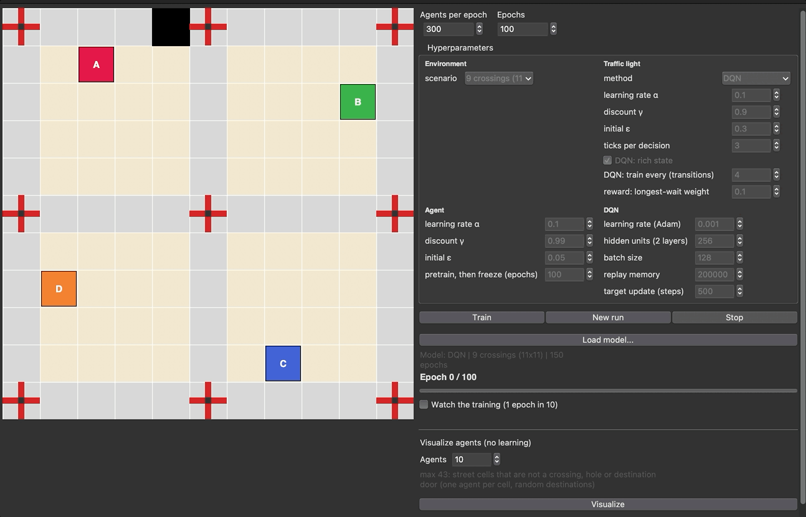

# CityRL

A traffic gridworld.



Streets forming blocks, a traffic light at each crossing, destination houses and holes. 
The map is flexible and scales to larger scenarios for comparison. 
The hyperparameter set is configurable through the UI or as arguments to the experiments cli.

Agents enter on any street cell (not a crossing, a hole or a destination door), walk to a destination and leave the simulation when they reach its door.

## How to run

```bash
uv run python main.py
```

## Experiments

Every scenario, every method, same seeds (same traffic) and same holes. 
The router is pretrained once per scenario + seed pair and reused by all methods:

```bash
uv run python -m cityrl.experiments --epochs 150 --seeds 3
uv run python -m cityrl.plots   # results/figures: one figure per scenario, scale.png and evaluation.csv
```

Output layout:

```
results/
  models/<scenario>/        model_<method>_seed<n>.pt (trained policies) and router_seed<n>.npy (pretrained router)
  experiments/<scenario>/   light_<method>_seed<n>.json (training curve + evaluation of each run)
  experiments/training.json every training run (interface and experiments)
  figures/                  <scenario>.pdf/.png, scale.pdf/.png and evaluation.csv
  logs/                     <command>_<date>.log: what cityrl.experiments, cityrl.models and cityrl.plots printed
```

`--set name=value` overrides a hyperparameter (e.g. `--set dqn_hidden_units=128 fairness_weight=0`). 
The evaluation runs the learned policy, without learning and with ε = 0.05, on 10-20 episodes never used in training.


## Trained models

Training saves the model (traffic light DQN weights or Q-table, router Q-table, hyperparameters and the map's holes)
to a `.pt` file, so it can be run again without training:

- Interface: at the end of training (or after Stop) the model is saved to
  `results/models/<scenario>/ui_<method>_seed<n>_<date>.pt`. **Load
  model...** opens a `.pt` file, restores its scenario and holes, and **Visualize** runs it without learning (greedy
  policy). **Train** after loading keeps training it.
- `cityrl.experiments` saves `results/models/<scenario>/model_<method>_seed<seed>.pt` for each run.
- To generate one model per scenario and method without running the whole experiment (reuses the pretrained
  `results/models/<scenario>/router_seed<seed>.npy` when it exists, and writes nothing under `results/experiments`):

```bash
uv run python -m cityrl.models --epochs 150                # results/models/<scenario>/model_<method>_seed0.pt
uv run python -m cityrl.models --scenarios "9 crossings (11x11)" --methods DQN --epochs 150
```

In the interface, **Agents** (under "Visualize agents") spawns that many agents at tick 0, one per street cell, with
random destinations. The maximum is the number of street cells that are not a crossing, a hole or a destination door
(43 on the 11x11 map). The settings panel scrolls when it does not fit the screen.

## Scenarios

| Scenario                  | Map   | Crossings | Destinations | Holes | Agents/episode |
|---------------------------|-------|-----------|--------------|-------|----------------|
| `T1: 9 crossings (11x11)` | 11×11 | 9         | 4            | 1     | 300            |
| `16 crossings (16x16)`    | 16×16 | 16        | 6            | 2     | 900            |
| `36 crossings (26x26)`    | 26×26 | 36        | 8            | 4     | 2200           |
| `64 crossings (36x36)`    | 36×36 | 64        | 10           | 6     | 4000           |

The scenario is chosen in the interface (Environment group) or with `--scenarios`. Holes are placed at most one
per street segment, so every door stays reachable.
